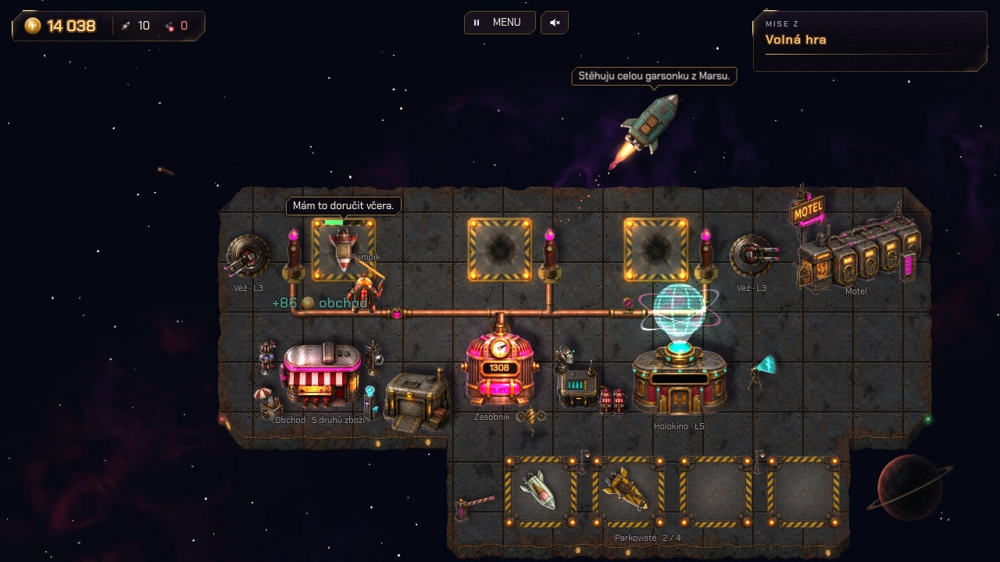

# Tower

Vesmírná čerpací stanice v noir ray-punk stylu. Převezmeš zrezivělou pumpu na kraji galaxie. Android Pumpík tankuje přilétající rakety galaxínem, stavební dron Bzučák staví a ty z vydělaných kreditů stanici rozšiřuješ a bráníš ji proti pirátům.

**[▶ Hrát v prohlížeči](https://radekdobrovolny.github.io/tower/)**



## O hře

- 2D hra s pohledem shora, napsaná v Godotu 4.7 (GDScript) a určená pro web.
- Kampaň má 9 misí, které jdou plynule za sebou. Každá trvá zhruba 2 až 6 minut a celá hra asi 35 minut. Stav stanice se mezi misemi přenáší.
- Postupně přibývají čerpací sloty, holokino pro čekající lodě, vlastní zásobník a nákup galaxínu od dodavatelů, obchod a skladiště, obranné věže, kořist z pirátů a rozšíření stanice s motelem a parkovištěm.
- V menu jde začít od kterékoli mise. **Mise Z** je volná hra, kde je všechno postavené a vylepšené na maximum.
- Mezi misemi probíhá příběh v rozhovorech s postavami.

## Ovládání

- Kliknutím na objekt (Pumpík, budova, zásobník, Bzučák) otevřeš info panel s popisem a vylepšeními.
- Kliknutím na prázdnou parcelu vybereš, co na ni postavit.
- Tlačítko **Menu** nebo klávesa **Esc** hru pozastaví.
- Na telefonu se hraje na šířku přes celý displej. Hru jde přidat na plochu jako aplikaci (PWA).

## Vývoj

Potřebuješ [Godot 4.7.2](https://godotengine.org/download/) (standardní verzi, ne .NET). Projekt otevřeš v editoru přes `project.godot`, nebo ho spustíš z příkazové řádky.

Import assetů (po naklonování nebo změně grafiky):

```bash
godot --headless --path . --import
```

Spuštění hry:

```bash
godot --path .
```

Rychlá kontrola chyb bez okna (60 snímků hlavního menu):

```bash
godot --headless --path . --quit-after 60
```

Webový export (potřebuje webové šablony exportu pro Godot 4.7.2):

```bash
godot --headless --path . --export-release "Web" build/web/index.html
```

Lokální test webového buildu na http://localhost:8060/:

```bash
python3 -m http.server 8060 --bind 127.0.0.1 --directory build/web
```

Export je PWA, takže prohlížeč může držet starou verzi v mezipaměti. Když po novém exportu vidíš staré chování, odregistruj service worker a smaž cache.

### Struktura projektu

| Složka | Obsah |
|---|---|
| `game/` | svět, kampaň a scény s postavami |
| `missions/` | mise jako zdroje `.tres` a jejich pořadí |
| `station/` | paluba, parcely a budovy |
| `economy/` | zásobník, dodávky galaxínu, řídící centrum, vetešník |
| `ships/`, `staff/`, `construction/` | lodě, Pumpík, Bzučák |
| `defense/`, `pirates/`, `loot/` | věže, piráti a kořist |
| `space/`, `fx/` | vesmírné pozadí, světla, stíny a shadery |
| `ui/`, `dialogue/` | HUD, menu, zápisník, hlášky a rozhovory |
| `audio/` | přehrávání zvuků |
| `assets/` | grafika, zvuky a písma |
| `tools/` | vývojářské skripty (generování zvuků, úprava obrázků, simulace vyvážení); do exportu se nedostanou |
| `docs/` | návrh hry a soupis misí |

### Dokumentace

- [docs/design.md](docs/design.md): návrh hry, vizuální styl, systémy a mise. **Obsahuje celý příběh, takže spoilery.**
- [docs/missions.md](docs/missions.md): cíle misí a nutné výdaje.
- [CLAUDE.md](CLAUDE.md): technické volby a konvence projektu.

## Grafika, zvuky a písmo

- Grafika je generovaná přes [SpriteCook](https://spritecook.ai) a Codex CLI podle vizuálního stylu v `docs/design.md`. ID obrázků ze SpriteCooku jsou v `spritecook-assets.json`.
- Zvuky jsou syntetizované kódem v `tools/generate_sfx.gd`, žádné nahrávky.
- Písmo [Chakra Petch](https://fonts.google.com/specimen/Chakra+Petch) je pod licencí SIL Open Font License (`assets/fonts/OFL.txt`).

## Nasazení

Každý push do větve `main` spustí workflow `.github/workflows/pages.yml`, který hru vyexportuje a nasadí na GitHub Pages.
